<div align="center">



<p>
  <a href="https://www.kutluhangul.com/"></a>
  
  
  
</p>

<p><em>My personal portfolio, themed as a grand hotel. It lives in one of two worlds<br>
and flips between them with a full sunrise and sunset animation.</em></p>

<a href="https://www.kutluhangul.com/"></a>

</div>



## Two worlds

- **Night**: the lobby after midnight. Ink black, brass lamplight and a flickering neon *VACANCY* sign.
- **Day**: the morning terrace. Sun-bleached linen, espresso ink and the same sign with the power off.

Toggle the light and the sun really rises or sets across the screen: stars switch on, a crescent moon climbs, birds cross at dawn, while the theme swaps underneath.

<table>
  <tr>
    <td width="50%"></td>
    <td width="50%"></td>
  </tr>
  <tr>
    <td align="center"><code>night</code> · the lobby</td>
    <td align="center"><code>day</code> · the terrace</td>
  </tr>
</table>


## What's on the site

| Section | |
|---|---|
| **The Lobby** | The hero with the live neon sign, a skills marquee and the full story. |
| **Case Studies** | Featured projects in scrubbable modals, so you can tour each app without leaving the page. |
| **The Workshop** | Every public repo, pulled live from the GitHub API on each visit. No redeploy needed. |
| **Credentials** | The GoIT Full Stack certificate, framed and downloadable. |
| **Blog, Now and Uses** | Writing, current focus and the daily toolkit, in the hotel's voice. |
| **The Guest Book** | A contact form and a live LinkedIn feed. |

<table>
  <tr>
    <td width="33%"></td>
    <td width="33%"></td>
    <td width="33%"></td>
  </tr>
</table>


## Türkçe özet

**kutluhangul.com**, büyük bir otel temasıyla tasarlanmış kişisel portfolyo sitem. Gece lobisi ile sabah terası arasında, güneşin gerçekten doğup battığı bir animasyonla geçiş yapıyor. Öne çıkan projeler, GitHub'dan her ziyarette canlı çekilen tüm depolar, sertifikalar, yazılar ve iletişim formu burada. Tüm metinler tek bir içerik dosyasından yönetiliyor.


## Development

```sh
npm install
PORT=3000 npm run dev     # port 5000 may be taken by AirPlay on macOS
npm run build
```

All site copy lives in `client/src/data/content.ts`: edit that one file to change text, never the components.

<div align="center">
<br>
<a href="https://github.com/kutluhangil"></a>
<sub>From front desk to front-end · the lights are always on.</sub>
</div>
